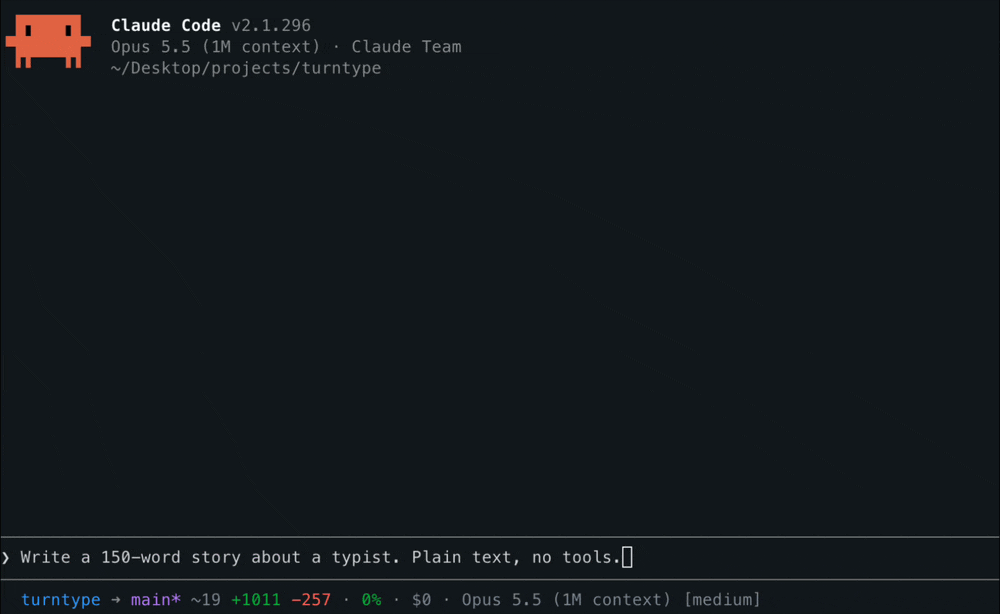

<h1 align="center">turntype</h1>

<p align="center">
  <b>A typing test for the seconds (and minutes) you spend watching Claude think.</b><br>
  A Claude Code mod.
</p>

<p align="center">
  
</p>

<p align="center">
  <a href="#install">Install</a> ·
  <a href="#how-it-plays">How it plays</a> ·
  <a href="#modes">Modes</a> ·
  <a href="#your-progress">Progress</a> ·
  <a href="#word-lists">Word lists</a> ·
  <a href="#keys">Keys</a> ·
  <a href="#settings">Settings</a>
</p>

---

I made this mod for fun, and it's inspired by [Monkeytype](https://monkeytype.com). The goal is to help me in my never-ending race to type faster. **This project is not related to Monkeytype in any shape or form.** It isn't made, endorsed or reviewed by the Monkeytype team. It borrows three of their word lists under their GPL-3.0 license ([details below](#credits-and-license)), and that's the whole connection.

Here's the idea. You send Claude a prompt, then you wait. You could scroll Twitter, or you could press `1` and type the fastest 30 seconds of your day.

## Install

You need **Claude Code 2.1.296 or later**, in the terminal. The Desktop app should work too, but nobody has tested it there yet ([notes](#notes-and-limitations)).

Type this at the Claude Code prompt:

```text
/plugin install turntype --marketplace Danovich/turntype
```

Answer `y` to add the marketplace, then press Enter for the user scope. turntype is active right away, in this session and every one after.

To try it for one session without installing it:

```shell
git clone https://github.com/Danovich/turntype
claude --plugin-dir ./turntype
```

The mods API is young and can change between Claude Code releases. If something looks off after an update, [open an issue](https://github.com/Danovich/turntype/issues) and say which version you're on.

## How it plays

### 1. Claude starts working

Once a turn has run for 3 seconds, a line shows above the prompt. Short turns never show it, so it stays out of your way when Claude answers fast.

```text
press 1: type while you wait ⋅ 2/5 min today ⋅ 4-day streak
```

The note after the dot is today's practice and your streak:

| You see | It means |
| --- | --- |
| `2/5 min today ⋅ 4-day streak` | You've typed 2 of your 5 daily minutes, and today counts toward the streak |
| `0/5 min today ⋅ keep your 4-day streak` | No test yet today. One test keeps the streak alive |
| `daily goal met (5 min) ⋅ 4-day streak` | Done for today. Typing more is still allowed |
| nothing | Your first day, with the goal off |

### 2. Press `1` (or run `/type`)

Press `1` in an **empty** prompt. If you've started writing a prompt, `1` is just a 1. You can also run `/type` at any time, Claude busy or not.

The game opens in a small pane above the prompt and takes the keys:

```text
the quick brown fox jumps over the lazy dog and then some
words that keep on coming while Claude reads your code
╌╌╌╌╌╌╌╌╌╌╌╌╌╌╌╌╌╌╌╌╌╌╌╌╌╌╌╌╌╌╌╌╌╌╌╌╌╌╌╌╌╌╌╌╌╌╌╌╌╌╌╌╌╌╌╌╌╌
█start typing ⏎ finish   your weak pairs: th er
◍ english_1k ❘ ∿ flow  ◷ time (30)  ☰ words (25)
```

Before the first key you can change the test in the toolbar on the last row. Press **Tab** to reach it, then Enter, or click. See [Modes](#modes) and [Word lists](#word-lists). When adaptive words are on and you have weak letter pairs, they show next to the field.

### 3. Type

The clock starts on your first key. Two lines of words show what to type: the line you're on, and the next one. When you finish a line, the next one moves up. The colors show how it's going:

| Look | Meaning |
| --- | --- |
| dim | still to type |
| white | typed right |
| red | a mistake: a wrong letter, or one you skipped |
| yellow, underlined | where your next key lands (on the space once a word is typed out) |

The field under the rule holds only the word you're on. The row under the field keeps score live. It has a row of its own, so it stays still while the word grows:

```text
while claude writes the code you can type a few words
words that keep on coming while Claude reads your code
╌╌╌╌╌╌╌╌╌╌╌╌╌╌╌╌╌╌╌╌╌╌╌╌╌╌╌╌╌╌╌╌╌╌╌╌╌╌╌╌╌╌╌╌╌╌╌╌╌╌╌╌╌╌╌╌╌╌
y█ ⏎ finish
0:12  52 wpm  7 words  esc: hide
```

- **wpm turns green** when you're at or above your personal best for this test, and **yellow** when you're under it. It waits 5 seconds before judging, because the first seconds swing wildly.
- **Words mode** counts down as `7/25`.
- **Time mode** counts down as `0:18 left`.

A few rules keep the score honest:

- **A space ends a word, and a finished word stays finished.** Backspace fixes the word you're on, not the one before it.
- Extra spaces before a word are ignored. So are letters typed past a word's end, because the next key there is the space.
- **A typo costs accuracy even after you fix it.** Accuracy counts the keys you pressed, not the text you ended with.
- **Pasting is not typing.** If one change of the field adds more than a few characters at once, the test can't set a personal best.

### 4. Take a break whenever

Stop typing for more than 2 seconds and the clock pauses:

```text
paused ⋅ type to resume
```

The pause doesn't count against your wpm, and that holds for a time test too: a 30-second test means 30 seconds of typing, not 30 seconds on the wall clock. The next key picks up where you left off.

Press **Esc** to hide the pane. A test in progress waits in the band:

```text
press 1: continue ⋅ 12 words
```

Press `1` to jump back in. A test you never typed in stays while Claude is still working, and goes away when the turn ends.

### 5. Claude finishes

In **flow** mode the test lasts as long as Claude does. When the turn ends, the status says so:

```text
∘ Claude is done ⋅ finish the word
```

Finish the word you're on, type the space, and the test ends. In time and words mode Claude finishing changes nothing. The test runs to its own end, or you press `⏎` to stop early.

If Claude was already done when you started (or you opened the game with `/type` while Claude was idle), a flow test has nothing to wait for. It says so, and runs until you press `⏎`:

```text
∘ Claude is done ⋅ ⏎ finish
```

### 6. The result

```text
62 wpm  96% accuracy  ✦ new personal best (+4)
▂▃▅▄▆█  ⇡ +5 vs week  today 3 tests ⋅ 4-day streak
╌╌╌╌╌╌╌╌╌╌╌╌╌╌╌╌╌╌╌╌╌╌╌╌╌╌╌╌╌╌╌╌╌╌╌╌╌╌╌╌╌╌╌╌╌╌╌╌╌╌╌╌╌╌╌╌╌╌
█ ⏎ again   x: close   d: details
◍ english_1k ❘ ∿ flow  ◷ time (30)  ☰ words (25)
```

The card is the same five rows as the game, so the pane never jumps.

**The card ignores keys for its first second.** A test often ends mid-word, and the keys you already sent shouldn't start a new test or close the card. After that second, the small field on the card takes every key: `⏎` or `a` starts again, `x` closes, `d` shows the details, and any other key does nothing. None of them leak into your prompt.

- **The personal best** reads one of:
  - `✦ new personal best (+4)`: you beat it, by this much
  - `✦ first personal best for this test`: your first fair result for this mode, count and list
  - `personal best 98 wpm`: not this time
  - `not a personal best try: ended early`: the test didn't qualify ([why](#what-counts-as-a-fair-test))
- **The sparkline** is your last 10 results for this exact test. `⇡ +5 vs week` compares this result with your average for the same test over the last 7 days.
- **`d` for details** swaps the trend row and the rule for two rows of detail: raw wpm, consistency, the test length, the words and today's total time, then correct, wrong, extra and missed characters. Details stay open for the next card until you press `d` again.
- **`⏎` or `a` for again** starts a fresh test. Change the toolbar first if you want a different one.
- **`x` to close.**

A new personal best also pops a toast, and so does each milestone the first time you reach it:

```text
✦ new personal best: 61 wpm ⋅ time 30 ⋅ first 60 wpm test
```

The milestones are 40, 50, 60, 70, 80, 90, 100, 120 and 150 wpm, and 3, 7, 30 and 100-day streaks.

### When a permission prompt shows up mid-test

Claude sometimes asks before it runs a tool, and the dialog takes the keys from the game. Once you answer it, turntype takes the keys back by itself, and your test keeps going.

It leaves the keys with you if you've started typing in the prompt, because you're clearly busy. The band then shows the way back:

```text
press 1: back to typing ⋅ 12 words   or ctrl+x tab
```

`ctrl+x tab` gives the keys back to the game from anywhere. The field shows the same hint when it doesn't have them.

### Where it doesn't run

The game needs somewhere to draw: the terminal, or the Claude Code Desktop app (untested so far). In the VS Code chat panel or with `claude -p`, `/type` tells you so and does nothing else.

## Modes

| Mode | The test ends when | `⏎` (Enter) |
| --- | --- | --- |
| `∿ flow` (default) | Claude is done and you finish the word. Started with Claude idle: only Enter ends it | Ends it, and it counts as complete |
| `◷ time` 15 / 30 / 60 / 120 | The typing time runs out (pauses don't count) | Ends it early |
| `☰ words` 10 / 25 / 50 / 100 | You type the last word (no space needed) | Ends it early |

Flow is the reason this mod exists: you type exactly as long as Claude works. Time and words are the classic tests, for when you want a number you can compare.

To change modes, use the toolbar under the field before your first key, or under the result card. Press a counted mode to see its counts (`◷ time  15  30  60  120`). The count in use is yellow, and a pick closes the list and puts you back in the field. Your picks are saved for next time.

Changed your mind while in the toolbar? Just start typing. The first letter goes to the field and starts the test, never into your prompt.

### What counts as a fair test

Each mode, count and word list keeps its own personal best. `time 15` never competes with `words 100`, and `english_10k` never competes with `english`. A test can set a personal best only if:

- nothing was pasted
- it wasn't ended early with Enter (flow is the exception, because Enter is its normal end)
- a flow test lasted at least 15 seconds
- accuracy was at least 75%

A test that misses one of these still counts toward today's minutes, your streak and your letter-pair practice. It just can't take the crown.

## Your progress

### Daily goal and streak

Every day with at least one test extends your streak. Days follow your own midnight, not UTC. The daily goal counts minutes of active typing, 5 by default. You can set it from 3 to 30 minutes, or turn it off and keep just the streak ([Settings](#settings)).

### Adaptive words

turntype notices the letter pairs you miss. If you keep hitting `r` when you meant `th`, then `th` is a weak pair. It counts the miss only while the word is still on track, so a single slip doesn't drag down every letter after it.

A pair has to show up at least 15 times, and you have to miss it often enough that it isn't noise. After that, about a third of the words in each new test contain one of your three weakest pairs. Older misses fade a little with each test, so a pair you've fixed drops out on its own. Your current weak pairs show next to the field before you start.

Adaptive words are on by default. Turn them off in [Settings](#settings) for plain random words.

## Word lists

| List | Words | Source |
| --- | --- | --- |
| `english` | 200 common words | turntype's own |
| `english_1k` (default) | the 1,000 most common | [Monkeytype](https://github.com/monkeytypegame/monkeytype) |
| `english_5k` | the 5,000 most common | [Monkeytype](https://github.com/monkeytypegame/monkeytype) |
| `english_10k` | about 10,000 | [Monkeytype](https://github.com/monkeytypegame/monkeytype) |

Pick one with `◍` in the toolbar.

### Add your own

Drop a JSON file in `word-lists/` and it shows up in the toolbar by its file name:

```json
{ "words": ["und", "der", "die", "das", "..."] }
```

- **The name** is the file name: lowercase letters, digits, `_` and `-`, so `german.json` shows as `german`.
- **At least 20 words.** A word has no spaces and at most 24 characters. Repeats are removed. Symbols are fine, so a list of `useState` and `=>` works for practicing code.
- **Broken files** show in the toolbar until you pick one. Then turntype says so, keeps your current list and drops the file from the toolbar.

turntype reads the list names when the session starts. It reads each list's words the first time you use that list, then keeps them.

## Keys

| Key | Where | What it does |
| --- | --- | --- |
| `1` | Empty prompt | Opens the game, continues a test, or takes you back after a dialog |
| `/type` | Prompt | Opens the game |
| `ctrl+x tab` | Anywhere | Gives the keys back to the game |
| `⏎` Enter | Game field | Ends the test |
| `Tab` | Game field, before the first key | Moves to the toolbar |
| `Esc` | Game pane | Hides the pane. A test in progress waits in the band |
| `⏎` or `a` / `x` / `d` | Result card, after its first second | Again / close / details |

## Settings

Set these in `/config`, under turntype:

| Setting | Options | Default |
| --- | --- | --- |
| Adaptive words | `on`, `off` | `on` |
| Daily goal (minutes) | `off`, `3`, `5`, `10`, `15`, `30` | `5` |

The mode, count and word list are set in the game's toolbar and remembered between sessions. The colors follow your Claude Code theme.

## Your data

Everything stays on your machine, in the mod's own store (`~/.claude/plugins/store/`):

- your toolbar picks
- personal bests, per test
- your last 200 fair results
- daily totals for the last 400 days
- letter-pair statistics

turntype sends nothing anywhere. If you run several Claude Code sessions at once, they share the store, and two tests finishing at the same moment both get saved.

## Notes and limitations

turntype is a mod living inside someone else's app, so a few things work around Claude Code rather than with it.

- **Not tested on the Desktop app.** turntype is built for the Desktop app as well as the terminal, and its automated tests draw both. But nobody has played it in the real Desktop app yet, and all the live testing ran in the terminal. If you try it there, [say how it went](https://github.com/Danovich/turntype/issues).
- **Permission prompts take the keys.** Claude Code gives the keys to the dialog, then hands them to the prompt when the dialog closes. turntype doesn't hear about it directly, so it checks every 0.4 seconds and asks for the keys back. Wait a beat after answering the dialog: a key typed in that moment can be lost, or land in the prompt, and Claude Code won't move the keys away from a prompt with text in it. Delete it and the game takes them back. turntype stops trying after 60 seconds, or when Claude's turn ends. If it gives up, press `1` in an empty prompt or `ctrl+x tab`.
- **`1` only works in an empty prompt.** With text in the prompt, `1` types a 1, and the game won't take the keys from your half-written message. Use `ctrl+x tab` or clear the prompt.
- **Give the invitation a moment.** Claude Code arms the `1` key a fraction of a second after the invitation appears. A `1` pressed in that instant types a 1 into the prompt. Delete it and press `1` again.
- **Very fast bursts can look like a paste.** turntype sees the field's text change, not single keys. When one change adds more than 3 characters, the test counts as pasted and can't set a personal best. If your terminal ever delivers four or more keys in one change, a real test gets flagged too.
- **Flow waits for you.** A flow test ends on the first space after Claude finishes. If you hid the pane, the test waits in the band until you come back and finish the word, or press Enter.
- **A finished word is final.** Backspace can't reach a word you've already ended with a space. This is on purpose, but it surprises people coming from editors.
- **New word lists need a reload.** turntype reads the list names when the session starts. After adding a file to `word-lists/`, run `/reload-plugins` or start a new session.
- **Updating mid-test can drop the test.** If a new turntype version changes how a test is stored, a test in progress during the update is dropped. Your saved results are safe.
- **The terminal and the Desktop app only.** The VS Code chat panel and `claude -p` have nowhere to draw the pane.
- **A field stays on screen.** Claude Code only hands a mod's pane the keys through a text field, so the word you're typing shows in a small field under the words. Typing straight into the words, as on Monkeytype, would need a click before every test.
- **Fullscreen puts the game in a sidebar.** In fullscreen mode, from 110 columns wide, Claude Code docks every pane beside the transcript, floor to ceiling, and a mod can't ask for the spot above the prompt instead. Narrower, or outside fullscreen, the game is a five-row block above the prompt. Resizing across that line mid-test moves the pane and briefly takes the keys from it, and turntype takes them back.
- **Tested on one Claude Code version.** The mods API is new and can change. turntype is tested with Claude Code 2.1.296, and a later release can break things until the mod catches up.

## Develop

```shell
claude plugin validate --strict .   # manifest, hooks and calls
claude plugin test .                # engine, flow, probe and cost tests
tsc -p .                            # types (Claude Code writes them into .claude-plugin/types/)
```

- `hooks/register.tsx` is the shell, the only code that talks to Claude Code.
- `hooks/engine/` holds the game rules as pure functions.
- `hooks/view/` draws the pane and the band.
- `tests/cost.test.ts` makes sure typing and the clock tick cost no extra redraws or host calls. A typing game that lags is worse than none.

The test kit has no real keyboard focus, and it can't press Esc or move `Date.now()`. So there's a live probe too. It drives turntype in a real Claude Code session in an iTerm2 window: it types, resizes and reads the screen, and saves screenshots of the moments worth a look. It needs macOS, iTerm2, and Screen Recording allowed for iTerm. It plays on a clean store and puts yours back after, so your stats stay untouched. Leave its window alone while it runs.

```shell
python3 -I tests/live/iterm-probe.py            # about 80 checks, no model calls
python3 -I tests/live/iterm-probe.py --turns    # plus two short model turns: Claude done, a permission dialog
python3 -I tests/live/iterm-probe.py --only words_test esc_and_back   # chosen cases alone
```

## Credits and license

turntype is free software under the [GNU General Public License v3.0 or later](LICENSE).

The word lists `english_1k`, `english_5k` and `english_10k` are copied unchanged from [Monkeytype](https://github.com/monkeytypegame/monkeytype) (`frontend/static/languages/`), © the Monkeytype contributors, under GPL-3.0. Thanks to them for the lists, and for the years of typing tests that inspired this one. The `english` list is turntype's own.

Monkeytype is a trademark of its owners. turntype is an independent fan project, not affiliated with or endorsed by Monkeytype.
